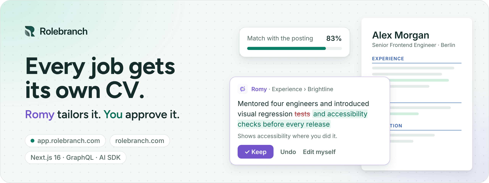
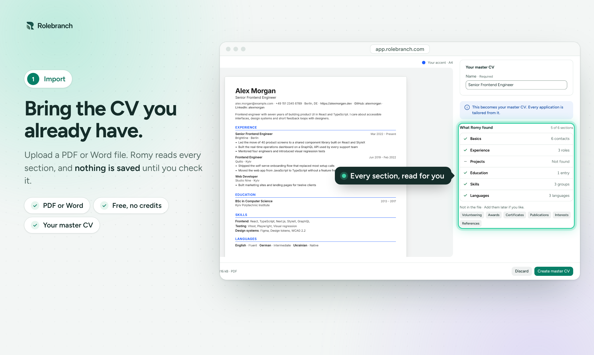
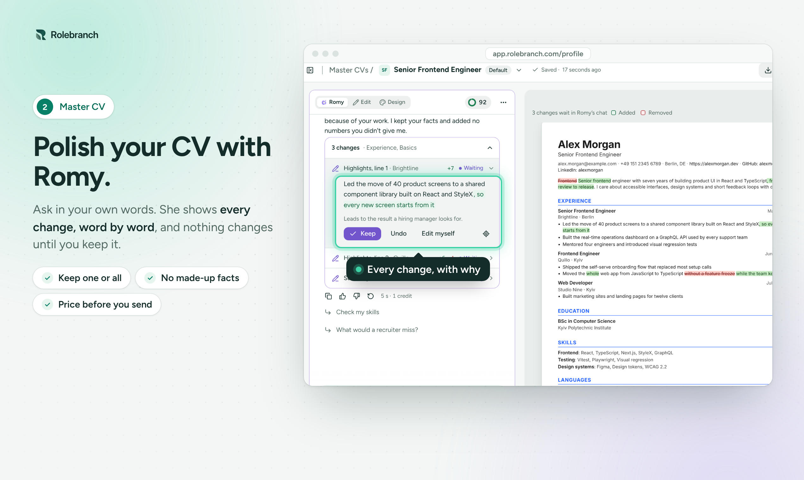
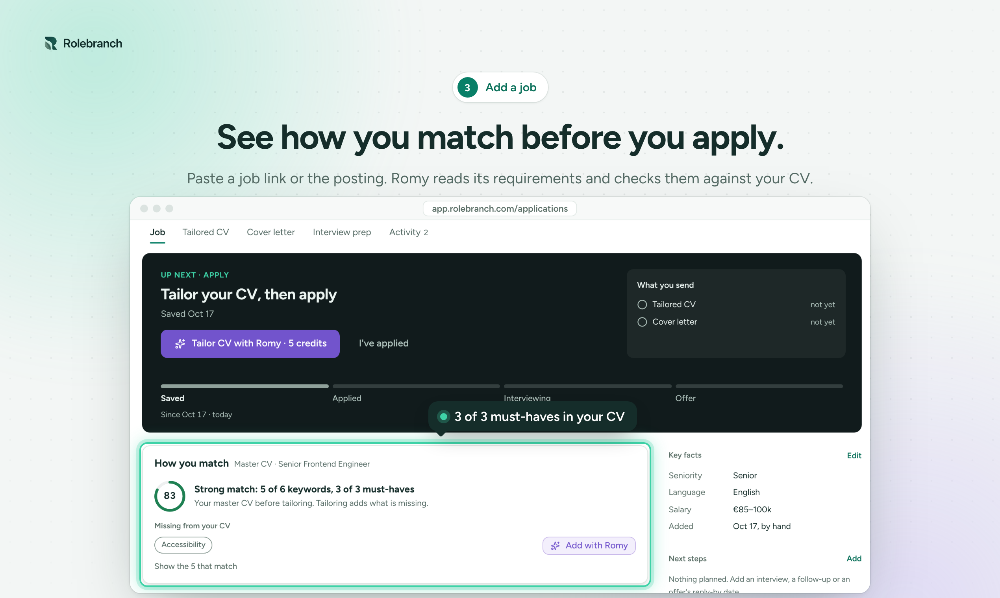
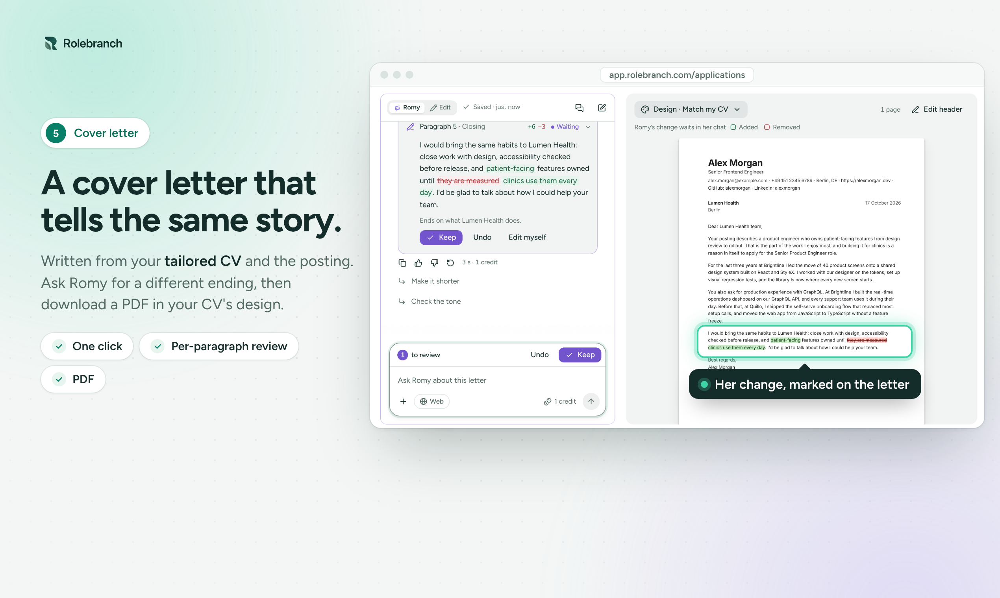
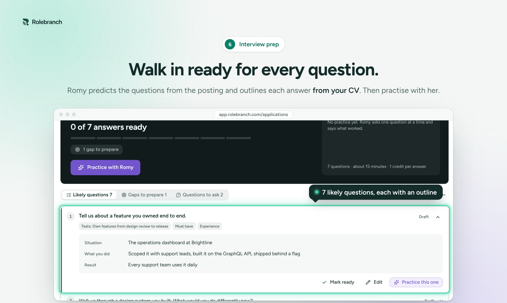
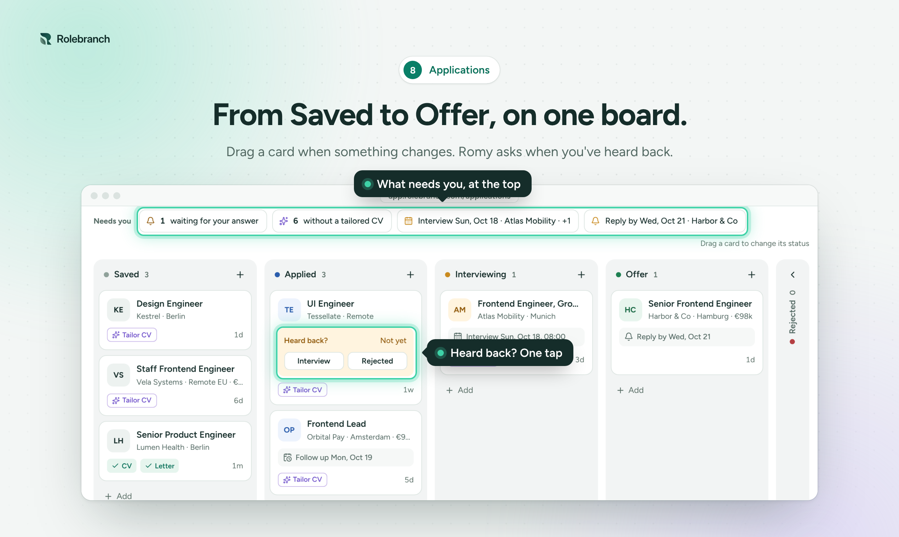
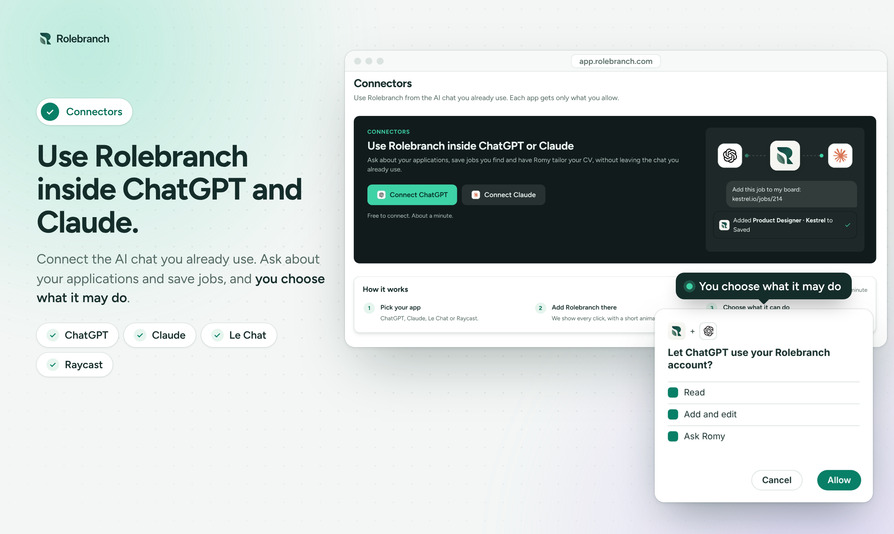

<picture>
  <source media="(prefers-color-scheme: dark)" srcset="https://raw.githubusercontent.com/Rolebranch/.github/main/profile/assets/banner-dark.png">
  
</picture>

  <a href="https://app.rolebranch.com"><b>Start free</b></a>
  &nbsp;·&nbsp;
  <a href="https://rolebranch.com">rolebranch.com</a>
  &nbsp;·&nbsp;
  <a href="https://rolebranch.com/whats-new">What's new</a>
  &nbsp;·&nbsp;
  <a href="https://rolebranch.com/help">Help centre</a>
  &nbsp;·&nbsp;
  <a href="https://rolebranch.com/about">About</a>

**Rolebranch is a personal AI CV builder for job seekers.** You keep one master CV. For every job
you apply to, Romy, its AI assistant, writes a tailored copy and a cover letter from it, then helps
you prepare for the interview. Each change she suggests waits for your Accept, so nothing goes out
with your name on it that you didn't approve.

Free during the beta: 100 welcome credits that never expire, plus 50 every month. No card.
In English, Deutsch, Français, Español, Italiano and Українська.

## How it works

1. **Bring your CV once.** Import a PDF or Word file, or start from scratch. It becomes your master
   CV: every role, project and result in one place, scored as you type.
2. **Add a job you want.** Paste the link or the posting. Romy reads its requirements, shows how you
   match, and writes a tailored CV and a cover letter from your master CV, never from thin air.
3. **Approve, then apply.** Accept or reject each change, download the PDF, track the job on your
   board and practise for the interview.

<table>
  <tr>
    <td width="50%"></td>
    <td width="50%"></td>
  </tr>
  <tr>
    <td></td>
    <td></td>
  </tr>
  <tr>
    <td></td>
    <td></td>
  </tr>
</table>

## Careful with the one document that speaks for you

- **No made-up numbers.** When a highlight could use a result Romy can't know, she leaves a blank
  and asks. Add one only if you measured it.
- **Every version kept.** Each accepted change and each save keeps a version you can restore. Your
  master CV is never overwritten.
- **Ten templates, all ATS-safe.** Single-column PDFs with real text and standard headings, so
  applicant tracking systems read them in order. Pick the font, spacing and colour for each CV, and
  [check yours against an ATS](https://rolebranch.com/ats-check).
- **A master CV per direction.** Keep one for each kind of role you're open to; each application
  starts from the one that fits.
- **Credits shown before anything runs.** A tailored CV costs 5 credits, and you see that before it
  starts. If a run fails, the credits come back. Editing, versions and PDF exports are always free.
- **On your phone.** Install Rolebranch from your browser; today's focus, the board and Romy fit in
  one hand.

## Connectors: Rolebranch inside the AI app you already use

Connect ChatGPT, Claude, Le Chat, Raycast or any other app that supports MCP. Instead of starting
from zero, the chat works from your master CVs and applications: check whether a posting is worth
applying to, ask which applications need a follow-up this week, or have Romy tailor a CV. You choose
what each app may do and how many credits a month it can spend. It never applies, sends or deletes,
and Romy's drafts wait for your review in Rolebranch.

## Built with

One TypeScript monorepo: Next.js 16 and React 19, a GraphQL API (Pothos), Postgres 17, and the
Vercel AI SDK through Vercel AI Gateway for Romy, deployed on Vercel. The app lives at
[app.rolebranch.com](https://app.rolebranch.com) and the public site at
[rolebranch.com](https://rolebranch.com). The source is private for now.

## A note from the founder

> I built Rolebranch to manage my own CVs: one master, a tailored copy and a matching cover letter
> for every application, and practice for the interview questions I always forgot. It's free while
> I learn what actually helps people get hired. If something is missing or broken, tell me. I read
> every request.
>
> Oleksandr Burda, founder

[Request a feature](https://rolebranch.com/help/request) · [contact@rolebranch.com](mailto:contact@rolebranch.com) · [How Romy uses your data](https://rolebranch.com/ai-and-data) · [Security](https://rolebranch.com/security)
